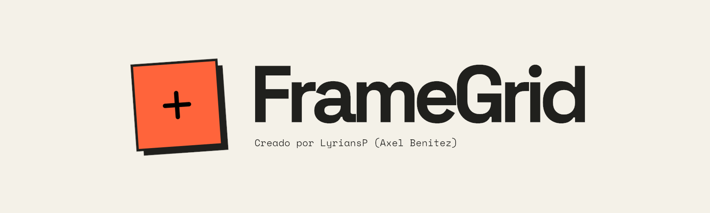

# FrameGrid

FrameGrid es un **Screenshot Sheet Generator**: una herramienta para reunir capturas e imágenes en una sola cuadrícula, ordenar su contenido y descargar una imagen lista para compartir. Todo se procesa directamente en tu navegador.

[Abrir FrameGrid](https://lyrians.github.io/FrameGrid/)

## Cargá tus imágenes

- **Seleccioná archivos** desde el botón **Subir imágenes**.
- **Arrastrá y soltá** imágenes en la pantalla de inicio o sobre la cuadrícula.
- **Pegá desde el portapapeles** con **Ctrl + V**, o **Cmd + V** en macOS.
- **Sumá más imágenes** desde **Agregar imágenes** o pegándolas dentro de la vista previa.

Admite imágenes estáticas **PNG, JPG/JPEG y WEBP**. Los archivos se procesan uno por vez, conservando el orden de carga. Podés cancelar la carga en curso; las imágenes que ya se incorporaron se conservan.

## Armá tu sheet

- **Reordená las imágenes** arrastrándolas dentro de la vista previa. También podés enfocar una imagen y usar **Alt + flechas**.
- **Quitá imágenes individuales** con la cruz de cada captura.
- **Elegí entre 1 y 6 columnas** y ajustá la separación de **0 a 32 px**.
- **Cambiá la proporción** entre clásico **4:3**, panorámico **16:9** y cuadrado **1:1**. Estos formatos usan recorte centrado para completar cada celda.
- **Conservá la imagen completa** con **Original · sin recorte**. Cada fila se adapta a la imagen más alta.
- **Elegí el fondo**: blanco, negro, naranja o verde salvia.
- **Empezá de nuevo** con **Nueva sheet**.

La vista previa se actualiza al cambiar los ajustes. La interfaz permanece fija y los paneles de vista previa y herramientas se desplazan por separado, también en pantallas pequeñas.

## Descargá el resultado

Elegí **PNG, JPG o WEBP**, escribí el **nombre del archivo** y descargá tu sheet. La extensión se agrega automáticamente según el formato seleccionado. Si dejás el nombre vacío, se utiliza **framegrid**.

El archivo respeta el orden, la distribución y el fondo elegidos e incluye la firma de FrameGrid. Si la salida supera los límites establecidos, se reduce proporcionalmente y se indica en la vista previa.

## Carga controlada

FrameGrid valida el formato, el peso y las dimensiones antes de abrir cada imagen. Permite hasta **40 imágenes**, con un máximo de **25 MiB por archivo**, **24 megapíxeles por imagen** y **12.000 px por lado**. También aplica límites acumulados de peso y resolución.

Si un archivo no se puede incorporar, muestra su nombre y el motivo, y continúa con los archivos válidos. Las imágenes animadas no se admiten.

## Privacidad

Tus imágenes se procesan en tu dispositivo. No se suben a un servidor y no necesitás crear una cuenta.
